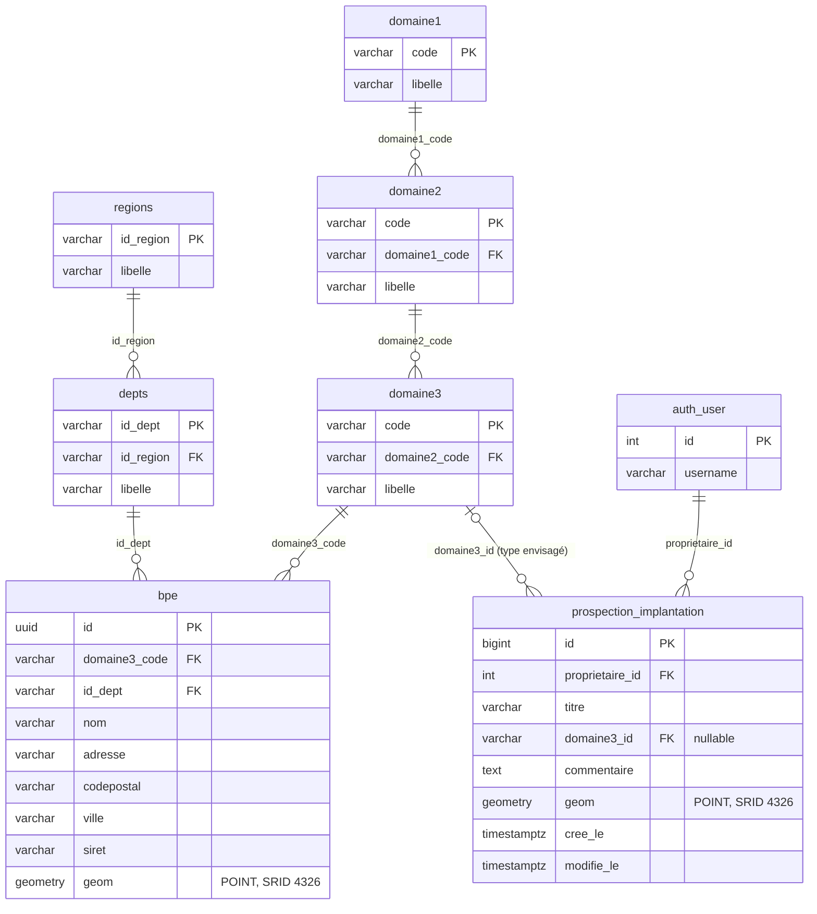

# Modèle de données – TerriScope

Base PostgreSQL 18 + PostGIS 3.6. Deux applications Django :

- **`bpe`** : le référentiel BPE 2025 en lecture seule, soit les 6 tables du schéma du sujet
  (noms de tables et de colonnes repris à l'identique via `db_table` et `db_column`) ;
- **`prospection`** : les implantations commerciales des utilisateurs, stockées à part du référentiel.

## Diagramme

## Tables du référentiel (`bpe`)

| Table | Clé primaire | Contenu | Lignes (région 24) |
| --- | --- | --- | --- |
| `regions` | `id_region` (`"24"`) | Libellé de la région | 1 |
| `depts` | `id_dept` (`"18"`, `"28"`…) | Libellé du département, rattaché à sa région | 6 |
| `domaine1` | `code` (1 car., ex. `F`) | Grand domaine (ex. *Sports, loisirs et culture*) | 7 |
| `domaine2` | `code` (2 car., ex. `F3`) | Sous-domaine, rattaché à un `domaine1` | 27 |
| `domaine3` | `code` (4 car., ex. `F307`) | Type d'équipement, rattaché à un `domaine2` | 235 |
| `bpe` | `id` (UUID, colonne `_id` du parquet) | Équipement : nom, adresse, code postal, ville, SIRET, position | 93 274 |

Répartition des équipements : Loiret 23 087, Indre-et-Loire 23 059, Eure-et-Loir 15 369,
Loir-et-Cher 12 588, Cher 10 597, Indre 8 574.

## Table des implantations (`prospection`)

`prospection_implantation` : un point par projet d'implantation, avec un titre, un type de commerce
envisagé (`domaine3`, optionnel), un commentaire, une position et les dates de création et de modification.
Chaque ligne appartient à un utilisateur (`proprietaire_id` → `auth_user`).

## Choix de conception

- **Positions** : `PointField(srid=4326)`, coordonnées GPS WGS 84 stockées dans l'ordre `Point(longitude, latitude)`.
- **Une seule clé étrangère vers `depts`** : le schéma du sujet montre à la fois `id_dept` et `dept` dans `bpe` ;
  ils sont fusionnés en une seule colonne `id_dept` pour éviter la redondance.
- **Libellés de la région et des départements écrits en dur** dans la commande d'import : ils sont absents du parquet.
- **Équipements sans coordonnées écartés** : sur les 97 095 lignes de la région 24, 3 821 n'ont pas de position
  exploitable. Elles ne peuvent pas être placées sur une carte ; 93 274 équipements sont importés.
- **Champs texte non nuls** : `nom`, `adresse`, `codepostal` et `siret` valent `""` quand la source est vide
  (31 676 équipements, surtout publics, n'ont pas de SIRET).
- **Implantations indépendantes du référentiel** : leur seul lien avec la BPE est la classification `domaine3`
  (le type de commerce envisagé), jamais un équipement. Si un type disparaît, le champ passe à `NULL`
  (`on_delete=SET_NULL`) ; si un utilisateur est supprimé, ses implantations le sont aussi (`CASCADE`).
- **Isolation** : l'API ne renvoie que les implantations de l'utilisateur connecté et fixe elle-même le
  propriétaire à la création (voir `docs/api.md`).

## Index

Tous créés automatiquement par les migrations Django :

- **GiST sur `bpe.geom`** : index spatial utilisé par le filtre `in_bbox` (opérateur `@` « contenu dans ») ;
- B-tree sur `bpe.ville` (`db_index=True`) pour le filtre et l'autocomplétion des villes ;
- B-tree sur chaque clé étrangère (`domaine3_code`, `id_dept`, `domaine2_code`, `domaine1_code`, `id_region`…) ;
- GiST sur `prospection_implantation.geom`.

## Ordre d'import

Les clés étrangères imposent l'ordre : `regions` → `depts`, puis `domaine1` → `domaine2` → `domaine3`, puis `bpe`.
La commande `import_bpe` respecte cet ordre dans une transaction unique (rien n'est écrit en cas d'erreur)
et peut être relancée : les référentiels sont insérés sans doublon et les équipements sont rechargés.
